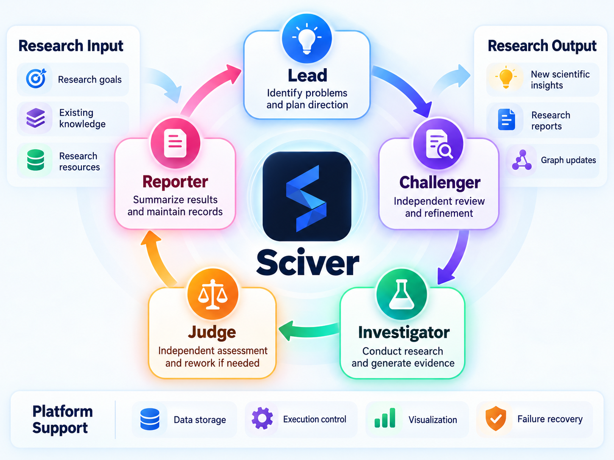
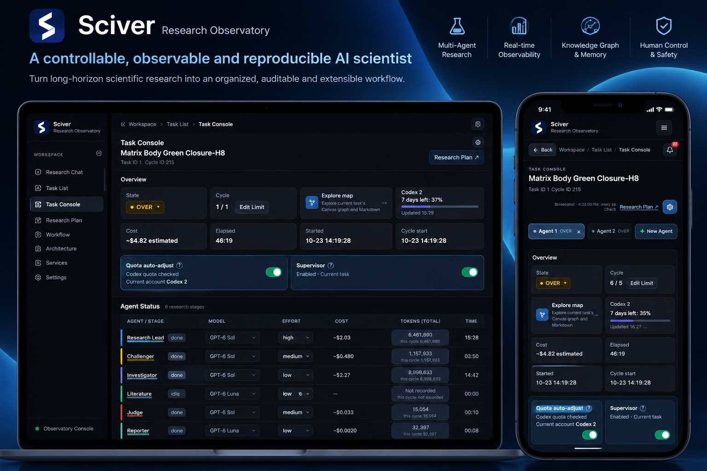

<p align="center">
  <picture>
    <source media="(prefers-color-scheme: dark)" srcset="docs/assets/brand/Sciver_Lockup_Horizontal_Blue_White.svg">
    <source media="(prefers-color-scheme: light)" srcset="docs/assets/brand/Sciver_Lockup_Horizontal_Primary.svg">
    
  </picture>
</p>

<h1 align="center">Sciver</h1>
<p align="center"><strong>Autonomous Scientific Discovery System</strong></p>
<p align="center"><em>Sci(ence)+(Disco)ver — from hypotheses to discoveries.</em></p>
<p align="center"><a href="README.md">English</a> · <a href="README.zh-CN.md">简体中文</a></p>

Sciver is built for complex, open-ended scientific questions that require sustained exploration. It helps researchers work with AI over time: clarify goals through conversation, follow progress and evidence across research stages, and adjust direction or intervene when needed. Research processes and artifacts are preserved for review, revision, and reproduction.

This repository contains the maintained source for the engine, agent workflows, and Web UI. It is separate from experiment data, researcher accounts, local deployment settings, and personal research workspaces.

## What is included

- **Research workflow engine** — orchestrates multi-stage, multi-agent scientific investigation.
- **Agent roles and skills** — reusable identities, instructions, and research procedures.
- **Web Observatory** — inspect persisted runs, review progress, and explicitly control research runs through the SDK.
- **Tests and design references** — regression tests and technical design documentation.

## System architecture

The diagram below summarizes Sciver's architecture and the lifecycle of a scientific Cycle, from candidate proposal and independent qualification through investigation, adjudication, and task-level completion.

<p align="center">
  
</p>

### Sciver Web Observatory

Inspect task status, research stages, and agent activity from desktop and mobile interfaces.

<p align="center">
  
</p>

## Repository layout

- `theory_master/` — core SDK, workflow orchestration, agent contracts, and runtime.
- `web/tm_observer/` — Web Observatory; install the Web package from `web/`.
- `tests/`, `web/tests/` — regression and integration tests.
- `design/`, `web/design/` — technical design notes.
- `theory_master/resources/skills/`, `identities/`, `scripts/` — project-supported skills, agent identities, and development tools.
- `config/.env.example` — credential-free configuration template.

Some package and CLI names retain historical `TheoryMaster`/`tm` naming. Those paths are implementation details and do not change the product name, Sciver.

## Quick start: give this to your Agent

Copy this prompt into your coding Agent:

```text
Please install and start Sciver for me. First check that Git and Python 3.11+ are available; on Windows, work inside WSL2. If a Sciver checkout already exists, preserve its changes, enter the checkout, and continue at the virtual-environment step. Otherwise run these commands in order:

git clone https://github.com/Black-Sage-xj/Sciver.git
cd Sciver
python3 -m venv .venv
source .venv/bin/activate
python -m pip install --upgrade pip
python -m pip install -e '.[sdk]' -e ./web
sciver quickstart

sciver quickstart performs the offline Test0 check and opens the Web UI; diagnose and retry any dependency or startup errors. Confirm the page is reachable, keep the server running, and give me a clickable Web UI link. If running remotely, set up secure port forwarding and give me the forwarded link. Do not start real research.
```

To do it yourself, use **Python 3.11+** on Linux, macOS, or Windows with WSL2:

```bash
git clone https://github.com/Black-Sage-xj/Sciver.git
cd Sciver
python3 -m venv .venv
source .venv/bin/activate
python -m pip install --upgrade pip
python -m pip install -e '.[sdk]' -e ./web
sciver quickstart
```

`quickstart` checks the original Test0 Brownian-motion data, initializes a task and SQLite graph, starts the local server, and opens **http://127.0.0.1:8787/**. The default workspace is `~/Sciver-workspace`, with the task in `test0/` and separate computation artifacts under `.theory-master-tasks/`. Generated files stay outside the source checkout. This is an offline installation check: it sends no model requests, starts no research, and produces no scientific verdict. Test0 has a **one-Cycle limit**; research begins only when you explicitly start it later. Repeating `quickstart` preserves your task and settings.

The browser opens in **Workspace → Research Chat** and shows a short guide on the first visit. To inspect the Test0 task just created, close the guide and open **Task List → test0**. You can view the task and its research plan without creating another project.

To create your own project, start from scratch or select an existing directory containing a `research_plan.md`, notes, or data. Choose the files to import. If you select an existing plan, Sciver uses it as input for a new draft and preserves the original directory and files. The conversation asks for your research goal, checkable completion criteria, and resource or method limits. Review or edit the Research Plan draft, then choose **Confirm project creation**. Only then does the project appear in **Task List**; research does not start automatically. Basic setup needs no model account. If you choose model-assisted drafting, excerpts from selected plans and notes are sent to the model and may consume quota.

To verify setup without starting the Web server:

```bash
sciver quickstart --no-web
```

### Start, stop, and reopen

```bash
sciver web                         # start the server and open the browser
sciver web --port 8788             # use another port if 8787 is occupied
sciver web --no-open               # print the URL on a headless/SSH machine
sciver quickstart --workspace ~/my-sciver
sciver web --workspace ~/my-sciver  # reopen the same workspace
sciver web --workspace ~/new-sciver # create an empty workspace and open the project guide
```

Keep the terminal running. Press `Ctrl+C` to stop the Web server; task files are preserved. In a new terminal, `cd Sciver`, run `source .venv/bin/activate`, then `sciver web`. For SSH, forward the port with `ssh -L 8787:127.0.0.1:8787 user@host` and open the printed URL on your own computer.

Local Web login is **off by default**. In **Settings → Web login**, you can enable a username and password for the current workspace. To recover a forgotten password, stop the server and run `sciver web --reset-login` (add the same `--workspace` if you used a custom one). This opens the Web UI with local login disabled so you can set new credentials.

You can also create a separate Test0 and open its Web UI immediately:

```bash
sciver test Test0 ~/Sciver-workspace/another-test0 --open
```

The destination must be empty. This command initializes and verifies the task; it does not start model-based research.

### Before starting real research

- Install a supported Codex CLI and log in to your model provider; the CLI is not bundled with the Python package. After installing the CLI, log in with `sciver codex-account login-1`, then check `sciver codex-account status`.
- Select available models and accounts in the Web UI. The model tier named `test` still makes real model requests and consumes quota; it is separate from the offline setup check.
- `sciver web` defaults to the active Python for computation. Run `python -m pip install numpy scipy` for numerical work, or run `export THEORYMASTER_COMPUTE_PYTHON=/absolute/path/to/python` to select your scientific environment. Explicit settings are preserved.
- External literature retrieval is optional for setup and viewing. The `research-lit` skill does not bundle a retrieval adapter. When needed, install a licensed `lit_retrieve.py` adapter in `~/.local/share/theory-master/scholarly-scripts`, or override the directory and interpreter with `THEORYMASTER_SCHOLARLY_SCRIPTS` and `THEORYMASTER_SCHOLARLY_PYTHON`.

## Run tests

Install test dependencies and list the available unittest categories:

```bash
python -m pip install -e '.[test]' -e ./web
python scripts/run_tests.py --list
```

Run the full core pytest gate used by CI with `python scripts/test_profiles.py default`. Run the categorized unittest suite with `python scripts/run_tests.py`, or run the invariant gate with `python scripts/run_tests.py --category invariant`. Some integration paths may require locally configured services or optional dependencies.

## Run the Web Observatory

```bash
tm-observer serve --search-root /path/to/your/research/workspace --host 127.0.0.1 --port 8787 --open
```

Open `http://127.0.0.1:8787/` locally. For remote access, configure your own authenticated reverse proxy or SSH tunnel. **Do not expose the server directly without authentication.**

The Web interface includes state-changing operations. Viewing task status, logs, and Canvas/Markdown documents is read-only; `run`, `resume`, `pause`, and `kill` change execution state through the SDK. Goal drafts, research plans, worker settings, and service/account controls can also write local state. Starting or resuming work can send model requests and consume provider quota. The UI is not a read-only access role. See [Web operation boundaries](web/README.md#operation-boundaries) for request protections and deployment details.

The `tm` CLI remains available for programmatic workflows and diagnostics; it is not required for using the Web interface.

The legacy interactive TUI is retained for compatibility but is not the preferred interface. Its retirement, if needed, will be handled separately.

## Contributing and license

See [CONTRIBUTING.md](CONTRIBUTING.md) for development and pull requests and [SECURITY.md](SECURITY.md) for reporting security issues. Avoid editing production research tasks during development.

The software in this repository is licensed under the MIT License; see [LICENSE](LICENSE). Sciver brand artwork, trademarks, and third-party materials may be subject to separate rights or notices. Do not assume that the MIT software license grants trademark rights; review applicable terms before reusing or redistributing those materials.
