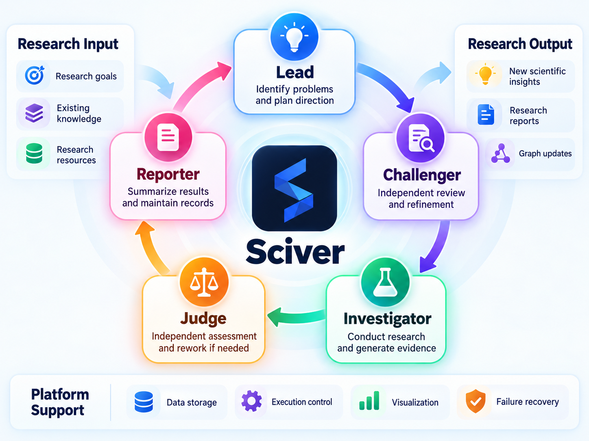
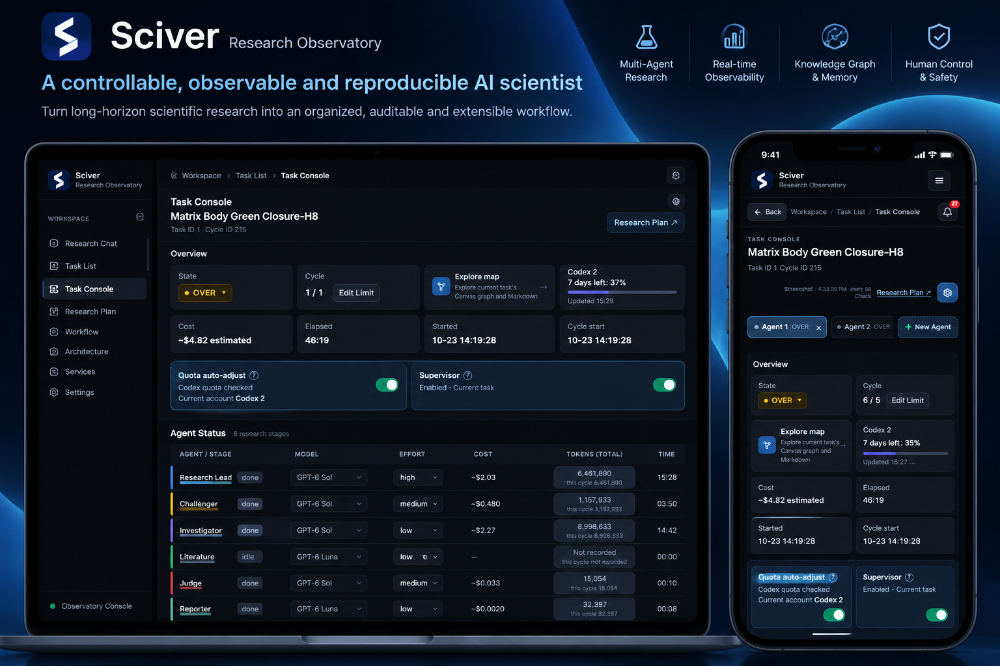

<p align="center">
  <picture>
    <source media="(prefers-color-scheme: dark)" srcset="docs/assets/brand/Sciver_Lockup_Horizontal_Blue_White.svg">
    <source media="(prefers-color-scheme: light)" srcset="docs/assets/brand/Sciver_Lockup_Horizontal_Primary.svg">
    
  </picture>
</p>

<h1 align="center">Sciver</h1>
<p align="center"><strong>Autonomous Scientific Discovery System</strong></p>
<p align="center"><em>Sci(ence)+(Disco)ver — from hypotheses to discoveries.</em></p>
<p align="center"><a href="README.md">English</a> · <a href="README.zh-CN.md">简体中文</a></p>

Sciver is built for complex, open-ended scientific questions that require sustained exploration. It helps researchers work with AI over time: clarify goals through conversation, follow progress and evidence across research stages, and adjust direction or intervene when needed. Research processes and artifacts are preserved for review, revision, and reproduction.

This repository contains the maintained source for the engine, agent workflows, and Web UI. It is separate from experiment data, researcher accounts, local deployment settings, and personal research workspaces.

## What is included

- **Research workflow engine** — orchestrates multi-stage, multi-agent scientific investigation.
- **Agent roles and skills** — reusable identities, instructions, and research procedures.
- **Web Observatory** — start a new project from a question or interest through Research Chat, develop a Plan, and confirm task creation; inspect existing graphs, reports, and runtime state, and carry out explicitly authorized research adjustments. See the [research collaboration guide (Chinese)](docs/research-chat-collaboration.zh-CN.md).
- **Tests and design references** — regression tests and technical design documentation.

## System architecture

The diagram below summarizes Sciver's architecture and the lifecycle of a scientific Cycle, from candidate proposal and independent qualification through investigation, adjudication, and task-level completion.

<p align="center">
  
</p>

### Sciver Web Observatory

Inspect task status, research stages, and agent activity from desktop and mobile interfaces.

<p align="center">
  
</p>

## Quick start: install the release (recommended)

For regular use, install the two `.whl` packages from [Release v0.1.1](https://github.com/Black-Sage-xj/Sciver/releases/tag/v0.1.1). They include the engine and prebuilt Web UI; Git and Node.js are not required. Use **Python 3.12+** on Linux, macOS, or Windows with WSL2. Replace `python3.12` below with your installed newer Python version if needed. For source development and editable installation, see [Contributing](CONTRIBUTING.md#development-installation).

### Give this to your Agent

Copy this prompt into your coding Agent to install Sciver, run the offline Test0 check, and open the Web UI:

```text
Please install and start the Sciver release for me. First check that Python 3.12+ is available; on Windows, work inside WSL2. Open https://github.com/Black-Sage-xj/Sciver/releases/tag/v0.1.1 and download sciver-0.1.1-py3-none-any.whl, tm_observer-0.1.1-py3-none-any.whl, INSTALL.md, and SHA256SUMS into ~/sciver-install/v0.1.1. Verify both wheel SHA256 checksums. No source checkout is needed; do not install the automatically generated Source code archives. Run these commands in order:

python3.12 -m venv "$HOME/sciver-venv"
source "$HOME/sciver-venv/bin/activate"
python -m pip install --no-index --find-links "$HOME/sciver-install/v0.1.1" 'sciver==0.1.1' 'tm-observer==0.1.1'
sciver smoke
sciver quickstart

If an installation, virtual environment, or source checkout already exists, inspect it first and preserve its changes, tasks, and account settings. If a new environment is needed, use an unused directory and adjust the commands accordingly. sciver quickstart performs the offline Test0 check and opens the Web UI; diagnose and retry any dependency or startup errors. Confirm the page is reachable, keep the server running, and give me a clickable Web UI link. If running remotely, set up secure port forwarding and give me the forwarded link. Do not start real research.
```

### Install it yourself

Download `sciver-0.1.1-py3-none-any.whl`, `tm_observer-0.1.1-py3-none-any.whl`, `INSTALL.md`, and `SHA256SUMS` from the Release page above into a new `~/sciver-install/v0.1.1` directory. Verify both wheels against the checksum list. Choose the `.whl` packages; the automatically generated **Source code (zip/tar.gz)** files contain source, not installable wheels. Then run:

```bash
python3.12 -m venv "$HOME/sciver-venv"
source "$HOME/sciver-venv/bin/activate"
python -m pip install --no-index --find-links "$HOME/sciver-install/v0.1.1" 'sciver==0.1.1' 'tm-observer==0.1.1'
sciver smoke
sciver quickstart
```

`smoke` checks installation with a fake backend. The two wheels support offline checks and Web viewing; before real research, install the SDK dependencies below and configure a model account.

`quickstart` checks the original Test0 Brownian-motion data, initializes a task and SQLite graph, starts the local server, and opens [http://127.0.0.1:8787/](http://127.0.0.1:8787/). The default workspace is `~/Sciver-workspace`, with fresh tasks in uniquely named `test-instances/test0-*` directories and separate computation artifacts under `.theory-master-tasks/`. Generated files stay outside the source checkout. This is an offline installation check: it sends no model requests, starts no research, and produces no scientific verdict. Test0 has a **one-Cycle limit**; research begins only when you explicitly start it later. Every `quickstart` creates a new task with empty scientific state and new Agent sessions from Cycle 1; historical tasks and workspace settings are preserved.

The browser opens in **Workspace → Research Chat** and shows a short guide on the first visit. To inspect the Test0 task just created, close the guide and open **Task List → the new Test0 task**. You can view the task and its research plan without creating another project.

To create your own project, start from scratch or select an existing directory containing a `research_plan.md`, notes, or data. Choose the files to import. If you select an existing plan, Sciver uses it as input for a new draft and preserves the original directory and files. The conversation asks for your research goal, long-term research boundaries and evidence standards, checkable completion criteria, and resource or method limits. Review or edit the Research Plan draft, then choose **Confirm project creation**. Only then does the project appear in **Task List**; research does not start automatically. Basic setup needs no model account. If you choose model-assisted drafting, excerpts from selected plans and notes are sent to the model and may consume quota.

For existing-project migration, the five Research Plan sections, and what happens after setup, see [Start with your own research](docs/START_HERE.md).

You can also begin with an interest and ask Research Chat to explore the literature. An independent Literature job plans complementary searches, selects papers, reads accessible sources, and compares mechanisms and open questions. Open its progress card to inspect sources and the report; candidate records, abstracts, readable bodies, and checked claims are shown separately. Discuss the results before reviewing a project plan and confirming creation. See the [Literature workflow (Chinese)](docs/literature-workflow.zh-CN.md) and its [live acceptance results (Chinese)](docs/literature-acceptance-20261118.zh-CN.md).

To verify setup without starting the Web server:

```bash
sciver quickstart --no-web
```

### Start, stop, and reopen

```bash
sciver web                         # start the server and open the browser
sciver web --port 8788             # use another port if 8787 is occupied
sciver web --no-open               # print the URL on a headless/SSH machine
sciver quickstart --workspace ~/my-sciver
sciver web --workspace ~/my-sciver  # reopen the same workspace
sciver web --workspace ~/new-sciver # create an empty workspace and open the project guide
```

Keep the terminal running. Press `Ctrl+C` to stop the Web server; task files are preserved. In a new terminal, run `source "$HOME/sciver-venv/bin/activate"`, then `sciver web`. For a source installation or a different environment directory, activate that environment instead. For SSH, forward the port with `ssh -L 8787:127.0.0.1:8787 user@host` and open the printed URL on your own computer.

Local Web login is **off by default**. In **Settings → Web login**, you can enable a username and password for the current workspace. To recover a forgotten password, stop the server and run `sciver web --reset-login` (add the same `--workspace` if you used a custom one). This opens the Web UI with local login disabled so you can set new credentials.

You can also create a separate Test0 and open its Web UI immediately:

```bash
sciver test Test0 ~/Sciver-workspace/another-test0 --prepare-only --open
```

Without `--prepare-only`, `test` starts real model-based research and uses account quota. The destination must be empty. This command initializes and verifies a fresh task; it does not start model-based research. For an automatically named task directory, use `sciver test Test0 --root ~/Sciver-workspace --prepare-only`. See [First use](docs/first-use.md) and [Wheel installation](docs/distribution.md) for standalone delivery, account setup and troubleshooting.

Fresh Test0 tasks declare a public JSON submission schema. Before Goal completion, Sciver validates the formally registered artifact against that schema; missing fields return to the original Investigator within its existing thread, budget and bounded correction allowance. Scientific acceptance still belongs to the Judge. Historical sealed tasks are preserved.

Each research Cycle tests one locked hypothesis. The Judge’s scientific assessment ends that experiment. When decisive evidence is missing, the next Cycle’s Research Lead receives the original objection and proposes a linked hypothesis for Challenger review. The earlier hypothesis has no terminal verdict. A terminal result of `supported`, `rejected` or `open` proceeds to a separate task-completion assessment.

### Before starting real research

- Release users should first run `python -m pip install --find-links "$HOME/sciver-install/v0.1.1" 'sciver[sdk]==0.1.1'` in the activated environment to install model-client dependencies. This step downloads extra dependencies; see [Wheel installation](docs/distribution.md) for fully offline deployment. The source development installation already includes the SDK dependencies.
- Install a supported Codex CLI and log in to your model provider; the CLI is not bundled with the Python package. After installing the CLI, log in with `sciver codex-account login-1`, then check `sciver codex-account status`.
- Select available models and accounts in the Web UI. The model tier named `test` still makes real model requests and consumes quota; it is separate from the offline setup check.
- `sciver web` defaults to the active Python for computation. Run `python -m pip install numpy scipy` for numerical work, or run `export THEORYMASTER_COMPUTE_PYTHON=/absolute/path/to/python` to select your scientific environment. Explicit settings are preserved.
- Literature discovery uses the bundled `tm-scholar` public scholarly connectors. Setup and offline viewing need no literature access. Model-assisted literature jobs use the selected account and quota; public APIs may be rate-limited and full text may be unavailable. Optional Marker/MinerU PDF conversion is configured in Settings and defaults to disabled; accessible HTML can still be read. `THEORYMASTER_SCHOLARLY_PYTHON` selects the scholarly Python runtime when needed.

## Repository layout

- `theory_master/` — core SDK, workflow orchestration, agent contracts, and runtime.
- `web/tm_observer/` — Web Observatory; install the Web package from `web/`.
- `tests/`, `web/tests/` — regression and integration tests.
- `design/`, `web/design/` — technical design notes.
- `theory_master/resources/skills/`, `identities/`, `scripts/` — project-supported skills, agent identities, and development tools.
- `config/.env.example` — credential-free configuration template.

Some package and CLI names retain historical `TheoryMaster`/`tm` naming. Those paths are implementation details and do not change the product name, Sciver.

## Run tests

Install test dependencies and list the full pytest inventory and categories:

```bash
python -m pip install -e '.[test]' -e ./web
python scripts/run_tests.py --list
```

Run the full core pytest gate used by CI with `python scripts/run_tests.py -q`; it includes function, parametrized and unittest tests. Use `python scripts/run_tests.py --category invariant` for the invariant gate, and `python -m pytest -q web/tests` for Web regressions. Browser tests require the explicitly enabled local browser runtime; real model tests require separate authorization.

## Run the Web Observatory

```bash
tm-observer serve --search-root /path/to/your/research/workspace --host 127.0.0.1 --port 8787 --open
```

Open `http://127.0.0.1:8787/` locally. For remote access, configure your own authenticated reverse proxy or SSH tunnel. **Do not expose the server directly without authentication.**

The Web interface includes state-changing operations. Viewing task status, logs, and Canvas/Markdown documents is read-only; `run`, `resume`, `pause`, and `kill` change execution state through the SDK. Goal drafts, research plans, worker settings, and service/account controls can also write local state. Starting or resuming work can send model requests and consume provider quota. The UI is not a read-only access role. See [Web operation boundaries](web/README.md#operation-boundaries) for request protections and deployment details.

The `tm` CLI remains available for programmatic workflows and diagnostics; it is not required for using the Web interface.

The legacy interactive TUI is retained for compatibility but is not the preferred interface. Its retirement, if needed, will be handled separately.

## Contributing and license

See [CONTRIBUTING.md](CONTRIBUTING.md) for development and pull requests and [SECURITY.md](SECURITY.md) for reporting security issues. Avoid editing production research tasks during development.

The software in this repository is licensed under the MIT License; see [LICENSE](LICENSE). Sciver brand artwork, trademarks, and third-party materials may be subject to separate rights or notices. Do not assume that the MIT software license grants trademark rights; review applicable terms before reusing or redistributing those materials.
