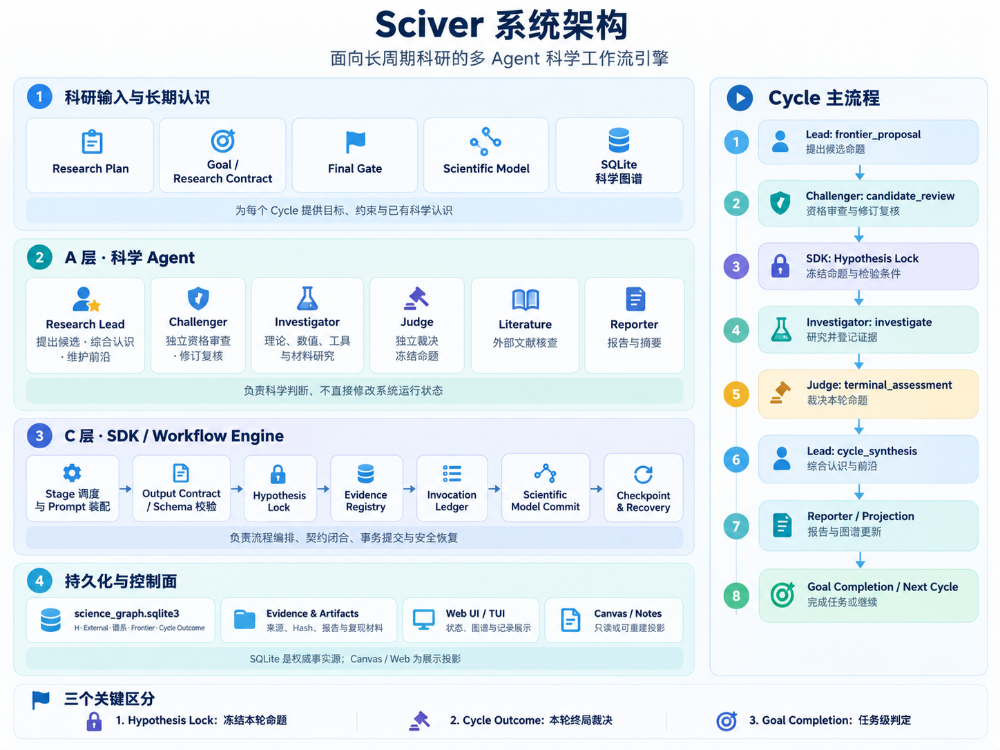
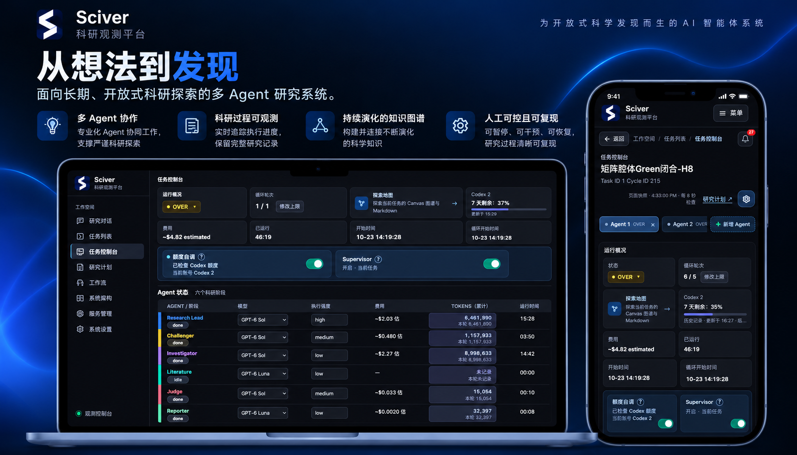

<p align="center">
  <picture>
    <source media="(prefers-color-scheme: dark)" srcset="docs/assets/brand/Sciver_Lockup_Horizontal_Blue_White.svg">
    <source media="(prefers-color-scheme: light)" srcset="docs/assets/brand/Sciver_Lockup_Horizontal_Primary.svg">
    
  </picture>
</p>

<h1 align="center">Sciver</h1>
<p align="center"><strong>自主科学发现系统</strong></p>
<p align="center"><em>Sci(ence)+(Disco)ver 从提出猜想到获得发现。</em></p>
<p align="center"><a href="README.md">English</a> · <a href="README.zh-CN.md">简体中文</a></p>

Sciver 面向复杂、开放、需要长期探索的科学问题，帮助研究者与 AI 持续协作推进研究。研究者可以通过对话明确研究目标，查看各阶段的进展与依据，并在需要时调整方向或介入。研究过程和产物会持续保存，便于审查、修正和复现。

本仓库包含引擎、Agent 工作流和 Web UI 的维护版本源码。实验数据、研究者账号、本地部署配置和个人科研工作区应与本仓库分开管理。

## 项目包含什么

- **科研工作流引擎**：编排多阶段、多 Agent 的科学调查过程。
- **Agent 角色与技能**：可复用的身份定义、指令和研究流程。
- **Web Observatory**：查看已持久化的运行记录、审查进度，并通过 SDK 显式控制科研运行。
- **测试与设计资料**：回归测试和技术设计文档。

## 系统架构

下图概览 Sciver 的系统分层与科研 Cycle 生命周期：从提出候选命题、独立资格审查，到开展研究、形成裁决，以及独立判断任务是否完成。

<p align="center">
  
</p>

### Sciver 网页观测台

通过桌面和移动端界面查看任务状态、科研阶段与 Agent 运行信息。

<p align="center">
  
</p>

## 仓库结构

- `theory_master/` — 核心 SDK、工作流编排、Agent 契约和运行时。
- `web/tm_observer/` — Web Observatory；Web 包从 `web/` 安装。
- `tests/`、`web/tests/` — 回归测试和集成测试。
- `design/`、`web/design/` — 技术设计文档。
- `theory_master/resources/skills/`、`identities/`、`scripts/` — 项目支持的技能、Agent 身份定义和开发工具。
- `config/.env.example` — 不包含凭据的配置模板。

部分包名和 CLI 命令仍保留历史上的 `TheoryMaster` / `tm` 命名。这些路径属于实现细节，不影响产品当前名称 Sciver。

## 快速开始：交给你的 Agent

复制下面这段给编程 Agent, 可以跑一个小的 扩散问题 ,以及看到 web ui：

```text
请帮我实际安装并启动 Sciver。先检查 Git 和 Python 3.11+ 是否可用；Windows 请在 WSL2 中操作。若已有 Sciver 仓库，保留其中的改动，进入仓库并从建虚拟环境那一步继续；否则依次运行：

git clone https://github.com/Black-Sage-xj/Sciver.git
cd Sciver
python3 -m venv .venv
source .venv/bin/activate
python -m pip install --upgrade pip
python -m pip install -e '.[sdk]' -e ./web
sciver quickstart

sciver quickstart 会完成离线 Test0 自检并打开网页；遇到依赖或启动错误请排查后重试。确认网页能访问，让服务保持运行，最后给我一个可点击的 Web UI 链接；若在远程环境，请配置安全端口转发并给出转发后的链接。不要启动真实研究。
```

自己动手时，在 Linux、macOS 或 Windows 的 WSL2 中使用 **Python 3.11+**：

```bash
git clone https://github.com/Black-Sage-xj/Sciver.git
cd Sciver
python3 -m venv .venv
source .venv/bin/activate
python -m pip install --upgrade pip
python -m pip install -e '.[sdk]' -e ./web
sciver quickstart
```

`quickstart` 会校验 Test0 的原创布朗运动数据、初始化任务和 SQLite 图谱，然后启动本地服务，自动打开 **http://127.0.0.1:8787/**。默认工作区是 `~/Sciver-workspace`，Test0 任务在其 `test0/` 子目录；计算产物放在工作区内独立的 `.theory-master-tasks/`，不会写回源码。这一步是离线安装自检：不会调用模型、启动研究或生成科研结论。Test0 的运行上限设为 **1 个 Cycle**，只有之后由你显式启动时才会开始研究；重复执行 `quickstart` 会保留已有任务和设置。

网页首先进入 **Workspace → Research Chat**，首次打开会弹出简短说明。若只想查看刚创建的 Test0，关闭说明，打开 **Task List → test0** 即可查看任务和研究计划，无需再建项目。

若要建立自己的项目，可从空白开始，或选择已有目录中的 `research_plan.md`、笔记和数据。导入时自行勾选文件；如果勾选已有计划，Sciver 会以它为参考生成一份新草稿，原目录和原文件保持不变。对话依次询问科研目标、可核验的完成标准、资源或方法限制。检查并可编辑 Research Plan 草稿后，点击「确认建立项目」，项目才会出现在 **Task List**，不会自动开始研究。基础建项无需模型账号；若选择模型辅助完善，选中计划和笔记的文本摘录会发送给模型，并可能消耗额度。

只做自检、不启动网页：

```bash
sciver quickstart --no-web
```

### 启动、停止和重新打开

```bash
sciver web                         # 启动服务并自动打开浏览器
sciver web --port 8788             # 8787 被占用时换一个端口
sciver web --no-open               # 无桌面/SSH 环境只打印网址
sciver quickstart --workspace ~/my-sciver  # 指定独立工作区
sciver web --workspace ~/my-sciver         # 再次打开同一工作区
sciver web --workspace ~/new-sciver        # 新建空工作区并打开项目引导
```

终端保持运行；按 `Ctrl+C` 停止网页服务，任务文件保留。以后打开新终端，先 `cd Sciver` 并执行 `source .venv/bin/activate`，再运行 `sciver web`。SSH 用户可用 `ssh -L 8787:127.0.0.1:8787 user@host` 转发端口，在本机打开打印的网址。

本机网页默认**不需要密码**。需要登录时，可在 **Settings → 网页登录** 中设置用户名和密码，设置仅对应当前工作区。忘记密码时，先停止服务，运行 `sciver web --reset-login`；如果使用了自定义工作区，带上相同的 `--workspace`。网页会以关闭登录的状态重新打开，之后可设置新密码。

也可以单独创建 Test0 并立即打开网页：

```bash
sciver test Test0 ~/Sciver-workspace/another-test0 --open
```

目标目录须为空；`test` 创建任务并校验数据，不会启动模型研究。

### 开始真实研究前

- 安装受支持的 Codex CLI，并完成模型提供方登录；CLI 不随 Python 包捆绑。安装 CLI 后，用 `sciver codex-account login-1` 登录第一个账号，再用 `sciver codex-account status` 检查状态。
- 在网页中选择可用模型与账号。名为 `test` 的模型档位仍会调用真实模型、消耗额度，与上述离线自检不同。
- `sciver web` 默认把当前 Python 作为计算环境；需要数值计算库时，执行 `python -m pip install numpy scipy`。也可先执行 `export THEORYMASTER_COMPUTE_PYTHON=/absolute/path/to/python` 指定已有科学 Python，显式设置会保留。
- 暂不配置文献检索也能完成离线自检和查看网页。`research-lit` 不捆绑外部检索适配器；需要时再安装有权使用的 `lit_retrieve.py`，默认目录为 `~/.local/share/theory-master/scholarly-scripts`，可通过 `THEORYMASTER_SCHOLARLY_SCRIPTS` 和 `THEORYMASTER_SCHOLARLY_PYTHON` 覆盖适配器目录与解释器。

## 运行测试

安装测试依赖并查看可用的 unittest 测试分类：

```bash
python -m pip install -e '.[test]' -e ./web
python scripts/run_tests.py --list
```

运行 CI 使用的完整核心 pytest 门禁：`python scripts/test_profiles.py default`。运行已登记的 unittest 分类测试集：`python scripts/run_tests.py`；只运行不变量测试门禁：`python scripts/run_tests.py --category invariant`。部分集成测试可能需要本地服务或额外依赖。

## 启动 Web Observatory

```bash
tm-observer serve --search-root /path/to/your/research/workspace --host 127.0.0.1 --port 8787 --open
```

在本机打开 `http://127.0.0.1:8787/`。如需远程访问，请自行配置经过身份验证的反向代理或 SSH 隧道。**不要在没有身份验证的情况下直接暴露服务。**

网页包含会改变状态的操作。查看任务状态、日志及 Canvas/Markdown 文档属于只读操作；`run`、`resume`、`pause`、`kill` 会通过 SDK 改变执行状态。目标草稿、研究计划、Worker 设置和服务/账号控制也可能写入本地状态。启动或恢复任务可能发起模型请求并消耗模型提供方额度。网页登录账号不等于只读角色。请求保护和部署说明见 [Web 操作边界](web/README.md#operation-boundaries)。

`tm` CLI 仍可用于程序化工作流和诊断，但使用网页界面不要求先使用 CLI。

旧版交互式 TUI 暂时保留以维持兼容性，但不是推荐的主要界面。若要退役，将通过单独变更处理。

## 参与贡献与许可证

开发和 Pull Request 流程请参阅 [CONTRIBUTING.md](CONTRIBUTING.md)；安全问题报告方式请参阅 [SECURITY.md](SECURITY.md)。开发期间请避免直接修改正式科研任务。

本仓库的软件采用 MIT 许可证，详见 [LICENSE](LICENSE)。Sciver 品牌图稿、商标及第三方材料可能另有权利或声明要求。MIT 软件许可证不代表自动授予商标使用权；复用或再分发这些材料前，请先核对适用条款。
